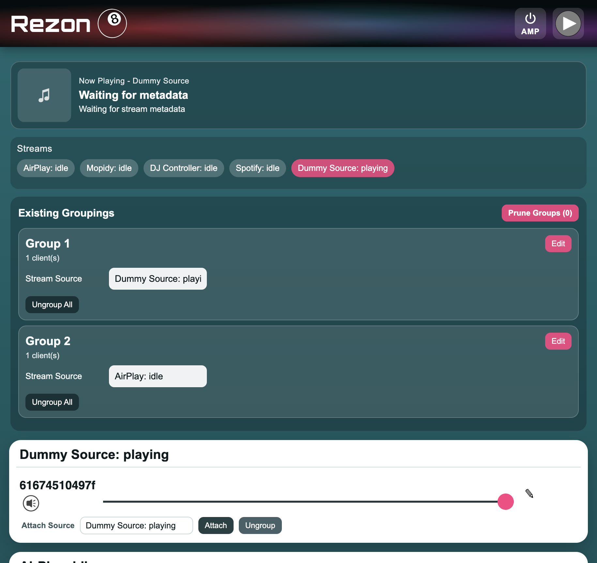
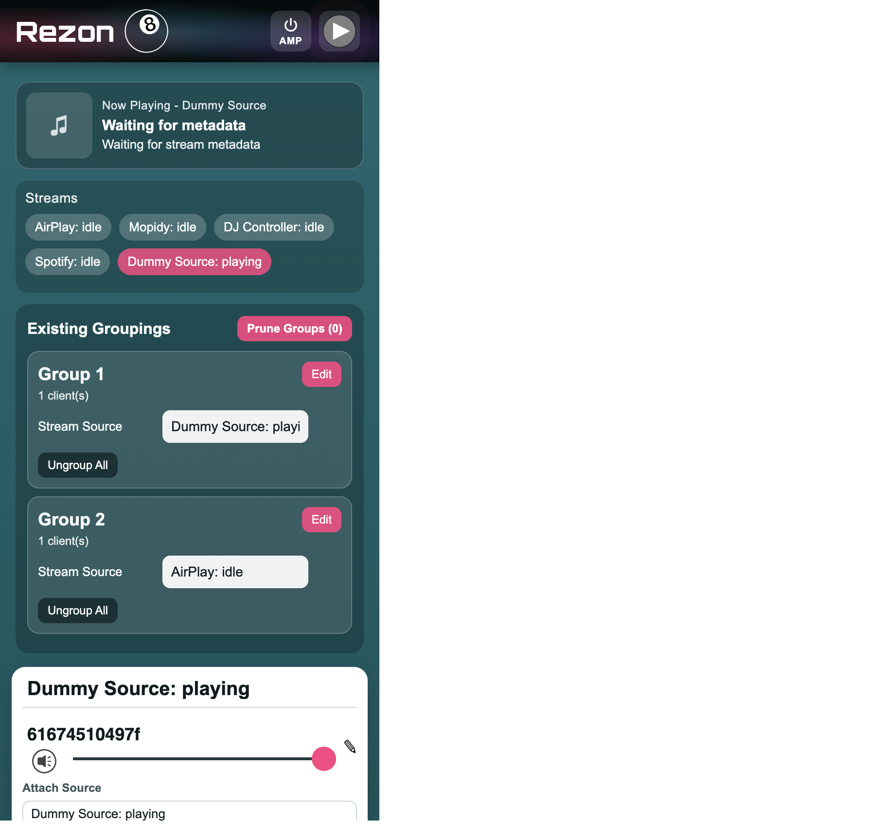

<h1>
  Rezon
</h1>

**Multi-room synchronized audio hub** — one Snapcast-based system for rooms, AirPlay, Spotify Connect, and DJ live feed.

- [CI](https://github.com/MrTiptop/Rezon8/actions/workflows/ci.yml)
- [Releases](https://github.com/MrTiptop/Rezon8/releases)

## What Rezon8 is

Rezon8 is a customized [Snapcast](https://github.com/badaix/snapcast) fork (`MrTiptop/Rezon8`). It is not a standalone music player. Audio sources feed `snapserver`; time-synced `snapclient` instances play the same stream in every room.

This repo adds:

- Rezon8-branded Snapweb UI
- Docker UX testbed for local Snapweb iteration
- DietPi deploy helpers and room hardware (amp servo)

Companion pieces stay outside this tree: **DJ Live Stream** is a separate Mac app/repo; **AirPlay** and **Spotify Connect** are Snapcast stream sources backed by `shairport-sync` and `librespot` on the host.

### Snapweb UI

<p>
  
</p>

<p>
  
</p>

## System overview

```text
  AirPlay devices ──► shairport-sync ──┐
  Spotify Connect ──► librespot ───────┼──► Rezon8 snapserver ──► snapclients (rooms)
  DJ Mac ──► dj_live_streamer ─────────┘         │
              (TCP PCM :4953)                    └──► Rezon8 Snapweb UI
```

Canonical home-Pi stream wiring lives in [`docker/snapcast-test/live-pi/snapserver.conf`](docker/snapcast-test/live-pi/snapserver.conf):

```ini
source = airplay:///shairport-sync?name=AirPlay&devicename=Rezon8
source = tcp://0.0.0.0:4953?name=DJ Controller&sampleformat=48000:16:2&mode=server
source = librespot:///librespot?name=Spotify&devicename=Rezon8
```

## Capabilities

### Sync / rooms

Core of this repository: `snapserver` + `snapclient`, groups/zones, JSON-RPC control, and the Rezon8 Snapweb control surface. Clients stay time-aligned with the server (typically under 0.2 ms skew). See [How sync works](#how-sync-works).

### AirPlay (shairport-sync)

Snapcast’s `airplay://` source launches [shairport-sync](https://github.com/mikebrady/shairport-sync) so iPhones/Macs can AirPlay to a device named **Rezon8**. The binary must be installed on the Snapserver host; Rezon8 does not vendor it. Version tracking for test images: [`docker/snapcast-test/stream-sources.versions.json`](docker/snapcast-test/stream-sources.versions.json). Upstream stream docs: [Configuration — airplay](doc/configuration.md#airplay).

### Spotify Connect (librespot)

Same pattern with `librespot://` and [librespot](https://github.com/librespot-org/librespot) as device **Rezon8**. Install the binary on the host; configure via `snapserver.conf`. Upstream: [Configuration — librespot](doc/configuration.md#librespot).

### DJ Live Stream (separate repo)

On a Mac, [dj_streamer](https://github.com/MrTiptop/dj_streamer) taps system audio (Rekordbox, etc.), serves an Icecast browser stream, and can optionally push raw PCM to Rezon8’s **DJ Controller** TCP source (`SNAPCAST_HOST` / port `4953`).

Install and usage stay in that repo — do not duplicate them here:

- GitHub: [MrTiptop/dj_streamer](https://github.com/MrTiptop/dj_streamer)
- On the Pi, ensure the DJ TCP source is present (see `live-pi/snapserver.conf` or `scripts/patch_dietpi_dj_stream.py`)

## Quick start (Docker UX testbed)

From this repo root:

```bash
docker compose -f docker-compose.snapcast-test.yml up -d --build
```

- Rezon8 Snapweb: `http://localhost:1780`
- JSON-RPC (HTTP): `http://localhost:1780/jsonrpc`

```bash
docker compose -f docker-compose.snapcast-test.yml down
```

Details: [`docker/snapcast-test/README.md`](docker/snapcast-test/README.md).

## DietPi / home setup

1. Copy `scripts/.env.dietpi.local.example` → `scripts/.env.dietpi.local` and set host/user/paths.
2. Deploy the Rezon8 Snapweb overlay:

```bash
./scripts/deploy_snapweb_to_dietpi.sh
```

3. Stream sources for the live Pi are documented in [`docker/snapcast-test/live-pi/snapserver.conf`](docker/snapcast-test/live-pi/snapserver.conf). DietPi helpers under `scripts/` can patch DJ TCP and related sources.
4. Optional amp power button servo (Snapweb → HTTP `POST /press`): [`scripts/servo-amp/README.md`](scripts/servo-amp/README.md).

## How sync works

`snapserver` captures PCM from configured sources (pipe, ALSA, TCP, process, PipeWire, airplay, librespot, …), encodes chunks (FLAC/Opus/Vorbis/PCM), and timestamps them. Each `snapclient` keeps continuous time sync and plays at the correct wall-clock time so rooms stay aligned.

```text
audio source → snapserver → network → snapclient → speakers
```

Binary protocol: [`doc/binary_protocol.md`](doc/binary_protocol.md).

## Upstream Snapcast docs

Packaging, build, and full core configuration (unchanged from upstream where applicable):

- [Installation](doc/install.md)
- [Build from source](doc/build.md)
- [Configuration](doc/configuration.md)
- [Player / source setup](doc/player_setup.md)
- [JSON-RPC control API](doc/json_rpc_api/control.md)

Upstream project: [badaix/snapcast](https://github.com/badaix/snapcast).

## Syncing with upstream Snapcast

Do **not** use GitHub’s “Sync fork” button alone — it can overwrite Rezon8 README, screenshots, and Snapweb assets with upstream Snapcast files.

Use the protected sync script instead:

```bash
./scripts/sync-from-upstream.sh          # merge upstream/master
./scripts/sync-from-upstream.sh develop  # or upstream/develop
```

That merge keeps Rezon8-owned paths (see `.gitattributes` / the script’s protected list). If you already synced via the GitHub UI and lost branding:

```bash
git checkout origin/UX -- README.md doc/rezon8_mark.png doc/screenshots docker/snapcast-test docker-compose.snapcast-test.yml scripts .gitattributes
```
